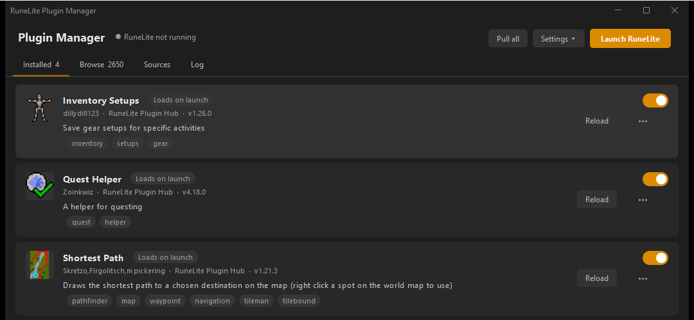
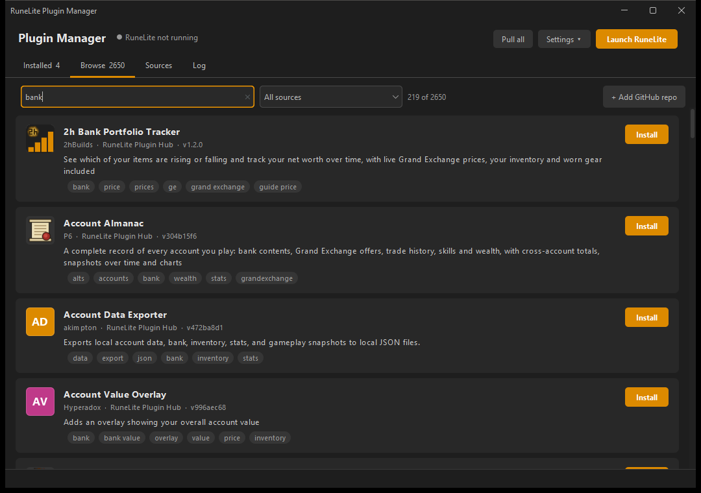

# RuneLite Plugin Manager

Sideload plugins into the **normal RuneLite** from runelite.net. No developer mode, no fork, no custom
client. Install, turn on, turn off and hot reload plugins while the game is open.



## What it does

Pulls plugins from wherever they live and shows them in one place, Plugin Hub style:

| Source | What you get |
|---|---|
| Official Plugin Hub | All ~2,600 Hub plugins. Prebuilt jars from repo.runelite.net, manifest signature and jar hash checked the same way RuneLite does it. |
| GitHub repo | `owner/repo` or any git URL. One plugin or a repo full of them. Built from source with Gradle, pulled and rebuilt when it changes. |
| Local project | A plugin you're working on. Tick auto-reload and it rebuilds and swaps itself in every time you save. |
| Jar folder | A folder of built plugin jars. |



- **Installed**: on/off switch per plugin, loads or unloads it live. Reload rebuilds and swaps it in.
- **Browse**: search everything, see name, author, description, tags, icon. Install pulls in anything it needs.
- **Sources**: add GitHub repos, local projects, jar folders, or scan a folder for plugin projects.
- **Launch RuneLite**: starts the official client with the manager hooked in. Plugins load once it hits the login screen.

Plugin repos with shared API plugins work too. If a plugin needs another one (`project(':Other')` in
Gradle or `@PluginDependency`), the dependency installs and loads first, and reloading it reloads
everything that uses it.

## How it works

Two parts.

- **agent**: a small Java agent added to RuneLite's JVM arguments at launch. Once the client is up, it
  loads plugin jars through RuneLite's own `PluginManager`, the same path RuneLite uses when you install
  something from the Plugin Hub. It listens on `127.0.0.1` only, behind a random token.
- **manager**: the app in the screenshots. Builds, downloads and stages jars, and tells the agent what to
  load.

The RuneLite install itself isn't touched. The launcher still updates and hash-checks the client like
normal; the agent is just one extra JVM argument.

## Client side only

Everything happens on your machine. The manager talks to GitHub (git), repo.runelite.net (Plugin Hub
manifest, jars, icons) and the agent on localhost. Nothing goes to Jagex.

What RuneLite itself can see, checked against the RuneLite source:

| | Sent anywhere? |
|---|---|
| Telemetry ping, error reports, crash logs | Off by default here (`--disable-telemetry`). Crash logs would include JVM arguments otherwise. |
| RuneLite's Plugin Hub install stats | Only lists plugins installed through RuneLite's own hub. Sideloaded ones aren't in it. |
| RuneLite profile sync | If you sync profiles to a RuneLite account, plugin config (including sideloaded plugins') goes with it. |

What Jagex's game code inside the same JVM could look at, I can't tell you. Plugins themselves are a
different story: they can do whatever their code does, so only run ones you trust. Breaking Jagex's
third-party client rules can still get you banned, sideloaded or not.

## Run it

Needs Windows, RuneLite installed from runelite.net, Git, and a Java 11 JDK for building plugins from
source (Plugin Hub plugins don't need building).

```
gradlew.bat build
tools\manager.bat
```

`manager.bat` runs the manager on RuneLite's bundled Java, so whatever Java is on your PATH doesn't
matter.

Settings live in `~/.rl-sideloader/manager.json`, the log in `~/.rl-sideloader/manager.log`.

## Known gaps

- **Jagex accounts**: the manager's Launch button starts RuneLite directly, so there's no Jagex Launcher
  session. Getting the agent in through "RuneLite (configure)" JVM arguments is untested.
- **Kotlin plugins** need the Kotlin standard library bundled in their jar. RuneLite doesn't ship it.
- Plugins with other third-party libraries need them bundled too.
- Hot reload is as clean as the plugin's `shutDown`. Plugins that leave threads or static state behind
  will leak a bit, restart now and then.

## Also in here

- `test-plugin/`: tiny plugin that adds a sidebar button, handy for testing reloads.
- `tools/launch.ps1` and `tools/rlctl.ps1`: start RuneLite with the agent and drive it from a terminal,
  no manager needed.

Not affiliated with RuneLite or Jagex.
